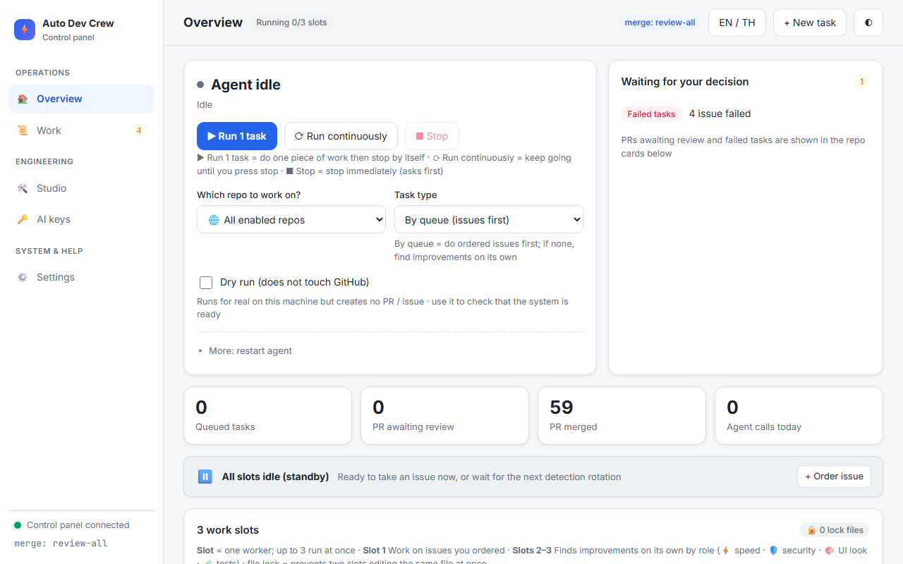

# Auto Dev Crew 🤖

[![ci][ci-badge]][ci-workflow]

**Auto Dev Crew is a local AI coding agent.** It takes work from GitHub issues and opens pull requests for that work. When no issues are waiting, four [personas](docs/glossary_EN.md) scan the code and look for improvements.

**Languages:** English (this file) · [ภาษาไทย](README_TH.md)

> **Status:** experimental project, public repository.



## Requirements
- Python 3.12 (the version CI uses)
- Git
- GitHub CLI (`gh`), signed in with `gh auth login`
- One AI engine: Antigravity CLI (`agy`) or OpenCode (`opencode`). See [providers and keys](docs/providers-and-keys_EN.md).
- Python packages listed in `requirements.txt` (installed in the steps below)

## Install
1. In the project folder, create and activate a virtual environment:
   ```powershell
   python -m venv .venv
   .venv\Scripts\Activate.ps1
   ```
2. Install the packages: `pip install -r requirements.txt`
3. Copy `config.example.yaml` to `config.yaml` and set `owner` to your GitHub login. `config.yaml` stays on your machine and is never committed.

## Give the agent work
- Open an issue in the target repository and add the label `ai-task`. Only issues opened by the `owner` account count.
- To stop the agent, add the label `ai-pause` to any open issue. Close that issue to resume.

## Run it
The local web GUI listens only on `127.0.0.1` and opens http://127.0.0.1:8765 in your browser:
```bash
python -m auto_dev_crew.gui
```
Options: `--port`, `--no-browser`, `--auto`. See the [GUI guide](docs/gui_EN.md).

Or use the command line ([details](docs/cli_EN.md)):
```bash
python -m auto_dev_crew --dry-run   # try locally; no push, PR, or comment
python -m auto_dev_crew             # do one task, then open a PR
python -m auto_dev_crew --loop      # keep going until no work or quota is left
```

## Settings to change first
| Setting | Default | Meaning |
|---|---|---|
| `owner` | `example-owner` (placeholder) | Your GitHub login. Only issues from this account are picked up. |
| `merge_mode` | `review-all` | `review-all` only opens PRs · `small-only` merges small PRs · `merge-all` merges when CI passes |
| `parallel.slots` | `3` | Number of parallel slots |

All settings are in [configuration](docs/configuration_EN.md). Provider API keys go in `.env`. Copy variable names from `.env.example`. Never paste key values into issues, logs, or docs.

## Run the tests
After the virtual environment step above:
```bash
python -m pip install -r requirements.txt pytest
python -m pytest -q
```
CI runs these two commands after it copies `config.example.yaml` to `config.yaml`. Rules for contributors are in [CONTRIBUTING.md](CONTRIBUTING.md).

## Project layout
- `auto_dev_crew/`: the Python package. `runner.py` runs the job queue. `gui.py` is the local web GUI.
- `prompts/`: prompts for issue work, test fixes, and the personas.
- `skills/`: skill folders (each has a `SKILL.md`). The skill registry loads them from here.
- `scripts/`: helper scripts, such as `gui_smoke.py` and `gui_e2e.py`.
- `tests/`: the pytest suite.
- `docs/`: documentation. Each page has an English file and a Thai file with the same name, for example `glossary_EN.md` and `glossary_TH.md`.
- `config.example.yaml`: the tracked config template. You create `config.yaml` from it on your machine.

## Learn more
- [Glossary](docs/glossary_EN.md) and [documentation index](docs/README_EN.md). Start with the [About page](docs/ABOUT_EN.md).
- [Configuration](docs/configuration_EN.md) and [command line](docs/cli_EN.md).
- [Contributing](CONTRIBUTING.md). [REQUIREMENTS.md](REQUIREMENTS.md) is an early design draft, kept as history. It is not the current spec.

[ci-badge]: https://github.com/OkayOkay101/auto-dev-crew-clean/actions/workflows/ci.yml/badge.svg?branch=main
[ci-workflow]: https://github.com/OkayOkay101/auto-dev-crew-clean/actions/workflows/ci.yml
