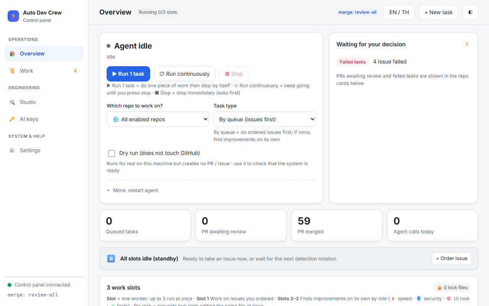

# Auto Dev Crew 🤖

[![ci][ci-badge]][ci-workflow]

**Auto Dev Crew คือเอเจนต์เขียนโค้ด AI ที่รันในเครื่องของคุณ** รับงานจาก GitHub issue แล้วเปิด pull request ให้ เมื่อไม่มี issue รอ [ตัวละคร](docs/glossary_TH.md) ทั้งสี่ (⚡🛡️🎨🧪) จะสแกนโค้ดเองและหาจุดที่ควรปรับปรุง

**ภาษา:** [English](README.md) · ภาษาไทย (ไฟล์นี้)

> **สถานะ:** โครงการทดลอง เป็น repository สาธารณะ



## ความต้องการของระบบ
- Python 3.12 (เวอร์ชันที่ CI ใช้)
- Git
- GitHub CLI (`gh`) ล็อกอินด้วย `gh auth login`
- เอนจิน AI ตัวใดตัวหนึ่ง: Antigravity CLI (`agy`) หรือ OpenCode (`opencode`) ดู [ผู้ให้บริการและคีย์](docs/providers-and-keys_TH.md)
- แพ็กเกจ Python ที่ระบุใน `requirements.txt` (ติดตั้งในขั้นตอนถัดไป)

## ติดตั้ง
1. ในโฟลเดอร์โปรเจกต์ สร้างและเปิดใช้งาน virtual environment:
   ```powershell
   python -m venv .venv
   .venv\Scripts\Activate.ps1
   ```
2. ติดตั้งแพ็กเกจด้วย `pip install -r requirements.txt`
3. คัดลอก `config.example.yaml` เป็น `config.yaml` แล้วตั้ง `owner` เป็นชื่อ GitHub ของคุณ ไฟล์ `config.yaml` อยู่ในเครื่องของคุณและไม่ถูก commit

## สั่งงานให้เอเจนต์
- เปิด issue ใน repository เป้าหมายแล้วติดป้าย `ai-task` ระบบจะหยิบเฉพาะ issue ที่เปิดโดยบัญชี `owner`
- เพื่อหยุดเอเจนต์ ติดป้าย `ai-pause` บน issue ที่เปิดอยู่ใดก็ได้ ปิด issue นั้นเพื่อให้ทำงานต่อ

## วิธีรัน
GUI บนเว็บในเครื่องรับการเชื่อมต่อเฉพาะจาก `127.0.0.1` (เครื่องของคุณเอง) และเปิด http://127.0.0.1:8765 ในเบราว์เซอร์:
```bash
python -m auto_dev_crew.gui
```
ตัวเลือก: `--port`, `--no-browser`, `--auto` ดู [คู่มือ GUI](docs/gui_TH.md)

หรือใช้บรรทัดคำสั่ง ([รายละเอียด](docs/cli_TH.md)):
```bash
python -m auto_dev_crew --dry-run   # ทดลองในเครื่อง ไม่ push, ไม่เปิด PR, ไม่คอมเมนต์
python -m auto_dev_crew             # ทำ 1 งาน แล้วเปิด PR
python -m auto_dev_crew --loop      # ทำต่อไปจนไม่มีงานหรือโควตาหมด
```

## การตั้งค่าที่ควรแก้ก่อน
| การตั้งค่า | ค่าเริ่มต้น | ความหมาย |
|---|---|---|
| `owner` | `example-owner` (ค่าตัวอย่าง) | ชื่อ GitHub ของคุณ ระบบจะหยิบเฉพาะ issue จากบัญชีนี้ |
| `merge_mode` | `review-all` | `review-all` เปิด PR อย่างเดียว · `small-only` merge เองเฉพาะ PR เล็ก · `merge-all` merge เองเมื่อ CI ผ่าน |
| `parallel.slots` | `3` | จำนวนช่องทำงานที่รันพร้อมกัน |

ดูทุกคีย์ได้ที่ [การตั้งค่า](docs/configuration_TH.md) คีย์ของผู้ให้บริการ AI ใส่ในไฟล์ `.env` คัดลอกชื่อตัวแปรจาก `.env.example` และห้ามวางค่าคีย์ลงใน issue, log หรือเอกสาร

## รันเทสต์
หลังขั้นตอนสร้าง virtual environment ข้างบน:
```bash
python -m pip install -r requirements.txt pytest
python -m pytest -q
```
CI รันสองคำสั่งนี้หลังคัดลอก `config.example.yaml` เป็น `config.yaml` แล้ว กฎสำหรับผู้มีส่วนร่วมอยู่ที่ [การมีส่วนร่วม](CONTRIBUTING.md)

## โครงสร้างโปรเจกต์
- `auto_dev_crew/`: แพ็กเกจ Python `runner.py` รันคิวงาน `gui.py` คือ GUI บนเว็บในเครื่อง
- `prompts/`: prompt ของงาน issue, การซ่อมเทสต์ และตัวละคร
- `skills/`: โฟลเดอร์สกิล (แต่ละโฟลเดอร์มี `SKILL.md`) skill registry โหลดจากโฟลเดอร์นี้
- `scripts/`: สคริปต์ช่วยงาน เช่น `gui_smoke.py` และ `gui_e2e.py`
- `tests/`: ชุดเทสต์ pytest
- `docs/`: เอกสาร แต่ละหน้ามีไฟล์ภาษาอังกฤษและไฟล์ภาษาไทยที่ชื่อเดียวกัน เช่น `glossary_EN.md` และ `glossary_TH.md`
- `config.example.yaml`: ไฟล์ตัวอย่างการตั้งค่าที่อยู่ใน git คุณสร้าง `config.yaml` จากไฟล์นี้ในเครื่องของคุณเอง

## อ่านเพิ่มเติม
- [คำศัพท์](docs/glossary_TH.md) และ [ดัชนีเอกสาร](docs/README_TH.md) เริ่มจาก [หน้าเกี่ยวกับ](docs/ABOUT_TH.md)
- [การตั้งค่า](docs/configuration_TH.md) และ [บรรทัดคำสั่ง](docs/cli_TH.md)
- [การมีส่วนร่วม](CONTRIBUTING.md) และ [REQUIREMENTS.md](REQUIREMENTS.md) เป็นร่างการออกแบบฉบับแรก เก็บไว้เป็นประวัติ ไม่ใช่สเปกปัจจุบัน

[ci-badge]: https://github.com/OkayOkay101/auto-dev-crew-clean/actions/workflows/ci.yml/badge.svg?branch=main
[ci-workflow]: https://github.com/OkayOkay101/auto-dev-crew-clean/actions/workflows/ci.yml
