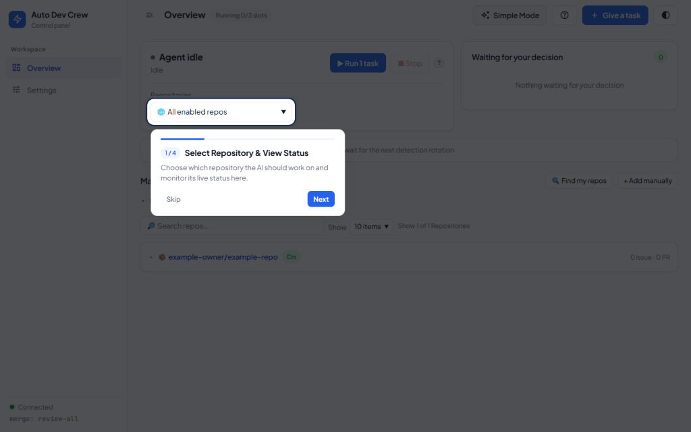
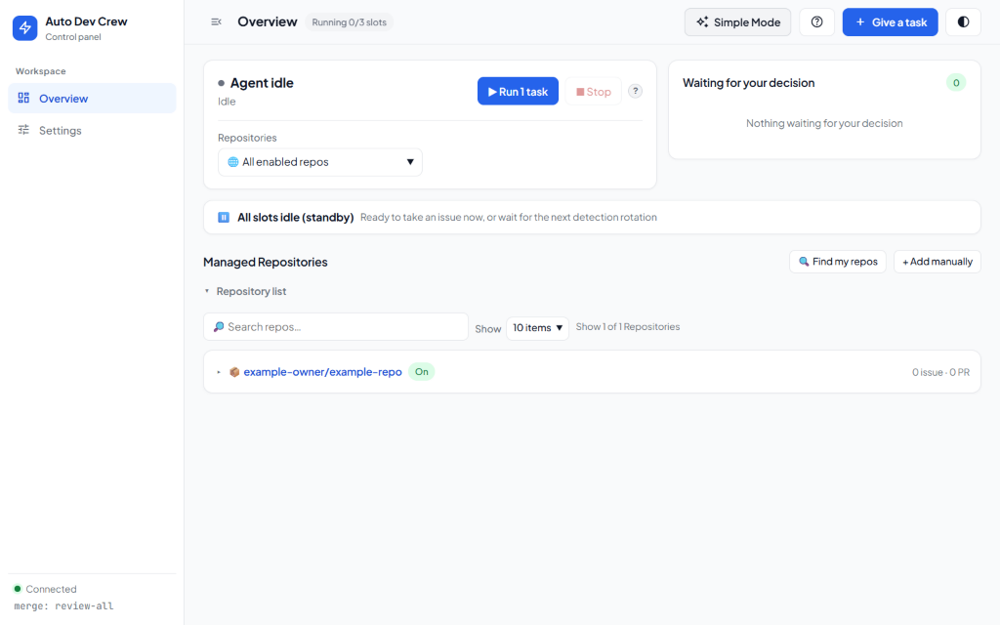
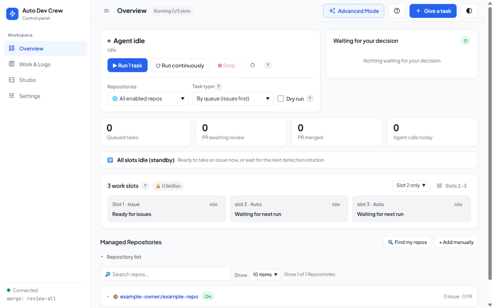
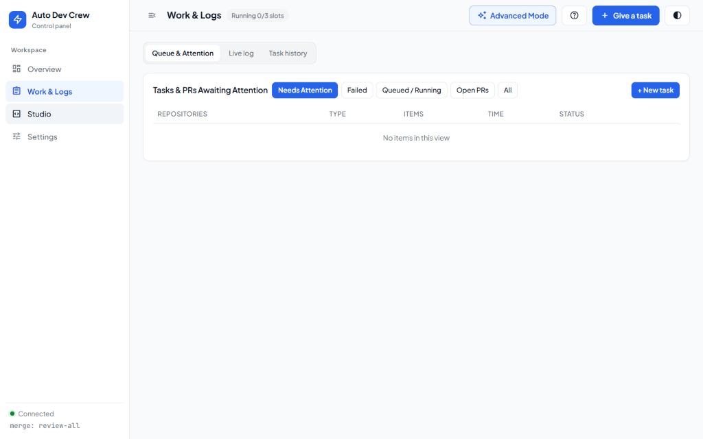
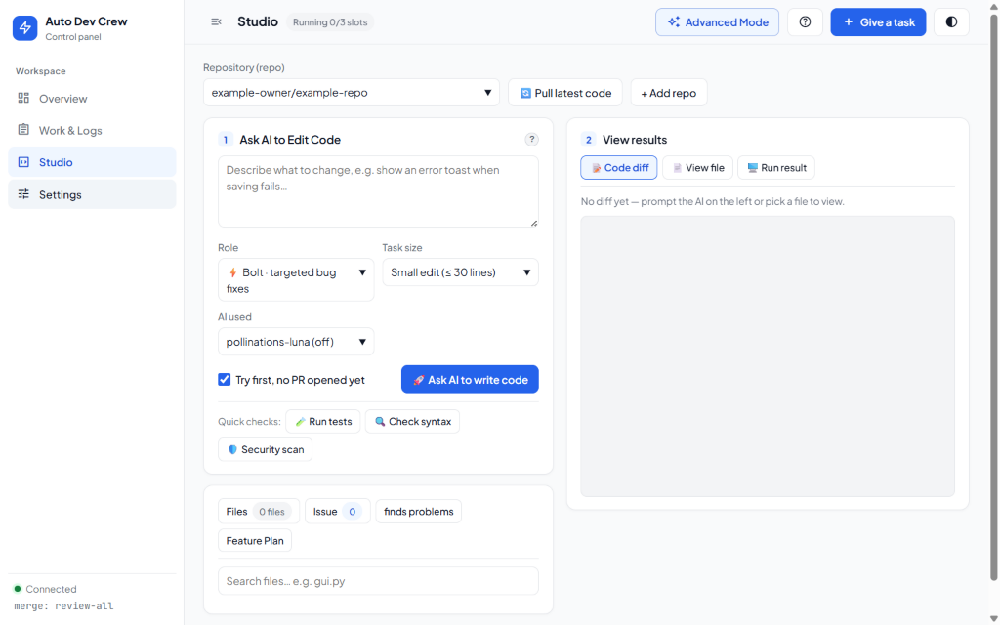

# Control Panel (GUI)

The GUI is a local web server built with Python's `http.server`. It uses no external web framework.

- Address: `http://127.0.0.1:8765/` (change the port with `--port`).
- It is bound to `127.0.0.1` only, so other machines on the network cannot reach it directly.

## 1. GUI security

- **Token:** each time the server starts, it generates a random token (`secrets.token_urlsafe`) and embeds it in the page. Requests that change data (POST) must send this token in the `X-Token` header. This stops other websites open in the same browser from sending commands.
- **Some read endpoints also require the token:** `/api/repo/file-content`, `/api/byop/status`, and `/api/byop/pool`.
- **Body size:** at most 1 MB per request. Larger requests get `413`.
- **Confirmation:** buttons that scan or create issues ask for confirmation first (`confirm()`). Do not bypass this with JavaScript.
- **Limits:** there is no password login in the GUI any more; the login system was removed. Remote access requires an SSH tunnel or another method set up by the administrator.

## 2. Simple Mode, Guided Tutorial, and the four main pages

By default, the GUI opens in **English** and **Simple Mode** (`adc_ui_mode = "simple"` in browser storage). On a first visit, a 4-step **Spotlight Guided Tutorial** opens automatically to walk through selecting a repository, creating a task, running one task, and switching modes. Click the **`?`** button in the top bar at any time to replay the tour.

The left navigation rail collapses and expands on desktop (and turns into a bottom bar on mobile). The top bar shows the page title, active slot count, the **Simple / Advanced Mode** toggle, the **`?`** tutorial button, the **+ New task** button, and the theme switcher (Auto / Light / Dark).

- **Simple Mode (default):** shows **Overview** and **Settings** in the sidebar and keeps Overview focused on repository selection, **Run 1 task**, **Stop**, and **Waiting for your decision**.

- **Advanced Mode:** click **Simple Mode** in the top bar (or switch in **Settings**) to unlock **Work & Logs**, **Studio**, continuous loop controls, KPI cards, and parallel slot assignments.

### 2.1 Overview

- **▶ Run 1 task:** do one piece of work, then stop automatically.
- **⟳ Run loop:** start `--loop` mode; keep working until you press stop or work runs out (Advanced Mode).
- **■ Stop:** cancel the job in progress. You are asked to confirm.
- **🔄 Restart:** icon button next to Stop. Cancels the job in progress and starts a new round with the same settings (Advanced Mode). Open PRs are not closed.
- **Action Inbox (Waiting for your decision):** lists PRs awaiting review and failed issues with direct **View diff** or **Manage →** buttons.
- **3 work slots:** single-row strip showing slots 1–3, a run-mode selector dropdown, and a **Slots 2–3** toggle to assign a persona or repository (Advanced Mode).
- **Managed repositories:** compact expandable rows; expand a row to view its issue / PR tables and per-repo settings.

Before restarting or stopping, check whether slots are idle. If a job is running, it will be cancelled.

### 2.2 Work & Logs

- **Queue & Attention:** unified filterable table of failed issues, queued/running tasks, and open PRs.
- **Live log:** the runner's log, updated in real time with slot 1–3 filters.
- **Task history:** past jobs. You can open the diff of each one.

### 2.3 Studio

- Two-column workspace: the left column handles AI edit prompts, quick checks (tests, syntax, security), and explorer tabs (**Files / Issues / Scan / Feature Plan**); the right column shows **Diff / File / Console** output.
- Find `[AI-TODO]` tags and create issues from them.
- Run a deep scan. See [architecture.md](architecture_EN.md#10-deep-scan).
- Feature plans (`ai-plan`). See [github-workflow.md](github-workflow_EN.md#4-feature-plans-ai-plan).

### 2.4 Settings

Organized into five sub-tabs:
- **General & Merge:** display language (`en` / `th`, defaults to `en`), UI Mode (`Simple Mode` / `Advanced Mode`), merge mode (`review-all`, `small-only`, `merge-all`), CI checks (`allow_no_ci`), AI quality check (`judge`), and **Shut down server**.
- **AI Keys & Models:** manage Pollinations (BYOP), provider keys, `coder` / `judge` / `scan` roles, and the `⋯` overflow menu (test, promote, delete). Details: [providers-and-keys.md](providers-and-keys_EN.md).
- **Failover:** set the failover order of engines.
- **AI Usage:** today's call history and per-key outcomes (from `state/usage.jsonl`).
- **System Tools:** Doctor, Playground, MCP Hub, Safe Revert Plan, and Terminology glossary.

## 3. Terms you will see

| Term | Meaning |
|---|---|
| Slot | One worker. Up to three can run in parallel. |
| Judge | The AI that scores code before a PR. Needs a key with the judge role. |
| Gates 1–4 | Checks before a PR is opened. See [architecture.md](architecture_EN.md#6-quality-gates). |
| Key role | `coder` (writes the main code), `judge` (scores), `scan` (looks for problems). |
| F6 failover | Move to the next provider when a quota runs out. |
| `ai-task` | An issue the agent will pick up. |
| `ai-plan` | An issue proposing a feature plan, waiting for approval. |
| Deep scan | The AI reads code section by section and reports problems. |

## 4. Things to know when changing values

- **If you edit `config.yaml` by hand, or change a key role:** restart the agent, and reload the page first. The engine list in the dropdown is read when the page loads.
- **A new `merge_mode`:** applies to the next merge decision. If you edited the file yourself, restart to be certain.
- **Switching to `merge-all`:** the GUI asks for confirmation first.

## 5. Running a runner outside the GUI

If you run `python -m auto_dev_crew --loop` from a terminal, the GUI sees that runner and can stop it with the stop button.

## 6. Testing the GUI

- `python scripts/gui_smoke.py`: read-only check that the page loads with no JavaScript errors. The GUI must be running and slots must be idle.
- `python scripts/gui_e2e.py --repo OWNER/NAME`: presses the run button in a dry run. Use a test repository only, and run only when slots are idle.

Details: [tools-and-scripts.md](tools-and-scripts_EN.md).

## 7. Known limitations

See [troubleshooting.md](troubleshooting_EN.md#2-known-limitations).
